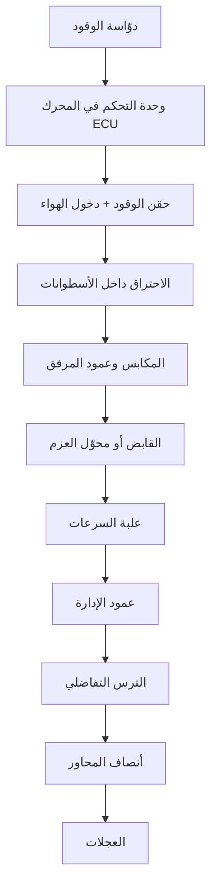

# تفكيك السيارة: الأنظمة والمكوّنات وكيف تعمل معاً

> شرح مبسّط لأجزاء السيارة التقليدية (محرك احتراق داخلي)، مع مقارنة سريعة بالسيارة الكهربائية، وجدول صيانة، وعلامات تحذيرية تدلّك على النظام الذي فيه المشكلة.
> المصطلحات الإنجليزية بين قوسين لتسهيل البحث وقراءة كتيّبات الصيانة.

---

## الفكرة الأساسية

السيارة آلة تحوّل الطاقة المخزّنة (وقود أو بطارية) إلى حركة يمكن التحكم بها. يمكن تقسيمها إلى خمس طبقات:

| الطبقة | وظيفتها | أهم الأنظمة |
|---|---|---|
| توليد القدرة | إنتاج الطاقة الحركية | المحرك، الوقود، الهواء، الإشعال، التبريد، التزييت، العادم |
| نقل القدرة | إيصال الحركة إلى العجلات | القابض، علبة السرعات، عمود الإدارة، الترس التفاضلي |
| الحمل والتحكم | حمل السيارة وتوجيهها وإيقافها | الهيكل، التعليق، التوجيه، الفرامل، العجلات |
| الكهرباء والإلكترونيات | تشغيل الأنظمة وإدارتها | البطارية، المولّد، محرك بدء التشغيل، وحدات التحكم، الحساسات |
| السلامة والراحة | حماية الركاب وراحتهم | الأحزمة، الوسائد الهوائية، أنظمة المساعدة، التكييف |

---

## مسار القدرة: من الدوّاسة إلى العجلة

> في سيارات الدفع الأمامي تكون علبة السرعات والترس التفاضلي في وحدة واحدة (Transaxle) ولا يوجد عمود إدارة طويل.

---

## 1. المحرك (Engine) — قلب السيارة

### المكوّنات الرئيسية

| المكوّن | الوظيفة |
|---|---|
| كتلة المحرك (Engine block) | الجسم الرئيسي الذي يحتوي الأسطوانات |
| رأس المحرك (Cylinder head) | يغلق الأسطوانات من الأعلى ويحمل الصمامات وعمود الكامات |
| المكابس (Pistons) | تتحرك صعوداً ونزولاً داخل الأسطوانات بفعل الاحتراق |
| أذرع التوصيل (Connecting rods) | تربط المكابس بعمود المرفق |
| عمود المرفق (Crankshaft) | يحوّل الحركة الترددية للمكابس إلى حركة دورانية |
| عمود الكامات (Camshaft) | يفتح الصمامات ويغلقها في التوقيت الصحيح |
| الصمامات (Valves) | صمامات سحب تُدخل الهواء، وصمامات عادم تُخرج الغازات |
| سير أو جنزير التوقيت (Timing belt/chain) | يزامن دوران عمود المرفق مع عمود الكامات |
| الحذّافة (Flywheel) | قرص ثقيل يخزّن الزخم ويُنعّم الدوران |

### دورة الأشواط الأربعة

1. **السحب (Intake):** ينزل المكبس ويُفتح صمام السحب فيدخل الهواء (مع الوقود أو بدونه حسب نوع الحقن).
2. **الضغط (Compression):** يصعد المكبس والصمامات مغلقة فيُضغط الخليط.
3. **القدرة (Power):** تُشعل شمعة الإشعال الخليط (في البنزين) أو يشتعل الوقود ذاتياً بسبب الحرارة الناتجة عن الضغط العالي (في الديزل)، فيندفع المكبس للأسفل. هذا هو الشوط الوحيد الذي يُنتج قدرة.
4. **العادم (Exhaust):** يصعد المكبس ويُفتح صمام العادم لطرد الغازات المحترقة.

كل أسطوانة تُكمل هذه الدورة مرة واحدة كل دورتين لعمود المرفق، والأسطوانات تشتعل بالتناوب ليبقى الدوران منتظماً.

---

## 2. الأنظمة المساندة للمحرك

### الوقود (Fuel system)
الخزان ← مضخة الوقود ← فلتر الوقود ← الحاقنات (Injectors). وحدة التحكم تحدد كمية الوقود وتوقيت حقنه بدقة.

### الهواء (Air intake)
فلتر الهواء ← حساس تدفق الهواء (MAF) ← صمام الخانق (Throttle body) ← مشعب السحب (Intake manifold).
في المحركات ذات **الشاحن التوربيني (Turbocharger)** تُدير غازات العادم توربيناً يضغط هواءً أكثر إلى المحرك، فيعطي قدرة أكبر من محرك أصغر.

### الإشعال (Ignition) — محركات البنزين فقط
ملفات الإشعال (Ignition coils) ترفع جهد البطارية إلى آلاف الفولتات، ثم تُطلق شمعات الإشعال (Spark plugs) الشرارة.
محركات الديزل لا تحتاج شمعات إشعال، لكنها تستخدم **شمعات التوهّج (Glow plugs)** لتسهيل التشغيل في البرد.

### التبريد (Cooling)
المضخة المائية (Water pump) تُدوّر سائل التبريد عبر المحرك ثم إلى **المشعاع/الرادياتير (Radiator)** حيث يبرد بالهواء ومروحة التبريد. **الثرموستات (Thermostat)** يتحكم في مرور السائل ليبقى المحرك قرب حرارة تشغيله المثالية (حوالي 90 درجة مئوية).

### التزييت (Lubrication)
مضخة الزيت تسحب الزيت من الحوض (Oil pan) وتمرّره عبر فلتر الزيت إلى الأجزاء المتحركة. الزيت يقلّل الاحتكاك، ويساعد على التبريد، وينظّف الرواسب.

### العادم (Exhaust)
مشعب العادم ← **المحوّل الحفّاز (Catalytic converter)** الذي يحوّل الغازات السامة إلى أقل ضرراً ← كاتم الصوت (Muffler) ← الأنبوب الخلفي.
حساسات الأكسجين (O2 sensors) تراقب الغازات لتضبط وحدة التحكم خليط الوقود. سيارات الديزل الحديثة تضيف **فلتر الجزيئات (DPF)**.

---

## 3. نقل الحركة (Drivetrain)

| المكوّن | الوظيفة |
|---|---|
| القابض (Clutch) | في اليدوي: يفصل المحرك عن علبة السرعات لتبديل السرعة |
| محوّل العزم (Torque converter) | في الأوتوماتيك التقليدي: وصلة هيدروليكية تؤدي دور القابض |
| علبة السرعات (Gearbox) | تختار نسبة التروس المناسبة للسرعة والحمل |
| عمود الإدارة (Driveshaft) | ينقل الحركة إلى المحور الخلفي في الدفع الخلفي والرباعي |
| الترس التفاضلي (Differential) | يسمح للعجلتين بالدوران بسرعتين مختلفتين في المنعطفات |
| أنصاف المحاور ومفاصل CV | توصل الحركة من الترس التفاضلي إلى كل عجلة |

**لماذا نحتاج علبة سرعات؟** المحرك يعطي أفضل أداء في نطاق دوران محدود. السرعات المنخفضة تضاعف العزم للانطلاق والصعود، والسرعات العالية تُخفّض دوران المحرك على الطريق السريع لتوفير الوقود.

**أنواع علب السرعات:** يدوية (Manual)، أوتوماتيكية (Automatic)، متغيرة باستمرار (CVT)، ثنائية القابض (DCT).

| نوع الدفع | العجلات التي تتلقى القدرة | أين يُستخدم غالباً |
|---|---|---|
| دفع أمامي (FWD) | الأماميتان | معظم السيارات الصغيرة والمتوسطة |
| دفع خلفي (RWD) | الخلفيتان | السيارات الرياضية والفاخرة والشاحنات |
| دفع كلي/رباعي (AWD/4WD) | الأربع | سيارات الدفع الرباعي والطرق الوعرة والثلج |

---

## 4. الهيكل (Body & Chassis)

- **الهيكل الأحادي (Unibody):** الجسم والإطار قطعة واحدة. أخف وأكثر أماناً في التصادم، وهو المستخدم في معظم السيارات.
- **الهيكل على شاسيه (Body-on-frame):** جسم مثبت فوق إطار فولاذي منفصل. أمتن للأحمال الثقيلة، ويُستخدم في الشاحنات الخفيفة (البيك أب) وبعض سيارات الدفع الرباعي.
- **مناطق الانهيار (Crumple zones):** أجزاء في المقدمة والمؤخرة مصممة لتنضغط وتمتص طاقة الاصطدام بدل أن تنتقل إلى الركاب.

---

## 5. التعليق (Suspension)

يحافظ على تلامس الإطارات مع الطريق ويمتص المطبات.

- **النوابض (Springs):** تحمل وزن السيارة. حلزونية، أو ورقية (Leaf) في الشاحنات، أو هوائية.
- **ممتصات الصدمات (Shock absorbers):** تُخمد ارتداد النوابض حتى لا تستمر السيارة في الاهتزاز.
- **أذرع التحكم (Control arms) والجلب المطاطية (Bushings):** تربط العجلات بالهيكل وتسمح لها بالحركة.
- **قضيب التوازن (Anti-roll bar):** يقلل ميلان السيارة في المنعطفات.

أشهر الأنواع: ماكفرسون (MacPherson strut)، العظمة المزدوجة (Double wishbone)، متعدد الوصلات (Multi-link).

---

## 6. التوجيه (Steering)

عجلة القيادة ← عمود التوجيه ← **الجريدة والترس (Rack and pinion)** ← أذرع التوجيه (Tie rods) ← العجلات الأمامية.
**المساعدة:** هيدروليكية بمضخة وسائل، أو كهربائية (EPS) بمحرك كهربائي، وهي الأشيع اليوم لأنها توفّر الوقود وتسمح بأنظمة مثل المساعدة على الركن.

---

## 7. الفرامل (Brakes)

1. تضغط على الدوّاسة، فيُضاعف **معزّز الفرامل (Brake booster)** قوة قدمك.
2. **المضخة الرئيسية (Master cylinder)** تحوّل الضغط إلى ضغط هيدروليكي في سائل الفرامل.
3. ينتقل الضغط عبر الأنابيب إلى **الكليبر (Caliper)** عند كل عجلة.
4. يضغط الكليبر **الفحمات (Brake pads)** على **القرص (Disc)**، فتتحول الحركة إلى حرارة وتتباطأ السيارة. بعض السيارات تستخدم **الطنبورة (Drum)** في الخلف.

- **ABS:** يمنع انغلاق العجلات عند الفرملة القوية حتى تبقى قادراً على التوجيه.
- **فرامل الانتظار (Parking brake):** يدوية بكابل، أو كهربائية بزر.

---

## 8. العجلات والإطارات

كيف تقرأ رمز الإطار، مثلاً **`205/55 R16 91V`**:

| الجزء | المعنى |
|---|---|
| 205 | عرض الإطار بالمليمتر |
| 55 | ارتفاع الجدار الجانبي كنسبة مئوية من العرض |
| R | بناء شعاعي (Radial) |
| 16 | قطر الجنط بالبوصة |
| 91 | مؤشر الحمولة: 615 كغ لكل إطار |
| V | مؤشر السرعة: حتى 240 كم/ساعة |

---

## 9. النظام الكهربائي

| المكوّن | الوظيفة |
|---|---|
| البطارية (12 فولت) | تُشغّل محرك بدء التشغيل والأنظمة والمحرك متوقف |
| محرك بدء التشغيل (Starter motor) | يُدير المحرك في البداية حتى يبدأ الاحتراق |
| المولّد (Alternator) | يُديره سير المحرك، فيشحن البطارية ويغذي الأنظمة (حوالي 13.5 إلى 14.5 فولت أثناء الدوران) |
| الأسلاك والفيوزات والمرحّلات (Relays) | توزّع الكهرباء وتحمي الدوائر من التحميل الزائد |
| الإنارة | المصابيح الأمامية والخلفية والإشارات وإضاءة لوحة العدادات |

---

## 10. الإلكترونيات والتحكم

- **وحدة التحكم في المحرك (ECU / ECM):** حاسوب يقرأ الحساسات ويتحكم في الحقن والإشعال والخانق.
- **وحدات أخرى:** لعلبة السرعات (TCU)، وللفرامل (ABS)، وللوسائد الهوائية، ولأنظمة الجسم كالأقفال والنوافذ (BCM).
- **شبكة CAN bus:** تتواصل عبرها كل هذه الوحدات.
- **أهم الحساسات:** موضع عمود المرفق، الأكسجين، حرارة سائل التبريد، تدفق الهواء، موضع دوّاسة الوقود، سرعة العجلات.
- **منفذ OBD-II:** موجود في معظم السيارات الحديثة تحت لوحة القيادة. بقارئ رخيص يمكنك قراءة رموز الأعطال، مثلاً `P0300` يعني احتراقاً غير منتظم في أسطوانات متعددة.

---

## 11. السلامة

- **السلامة السلبية** (تحميك أثناء الحادث): أحزمة الأمان، الوسائد الهوائية، مناطق الانهيار، مساند الرأس.
- **السلامة النشطة** (تمنع الحادث): ABS، التحكم الإلكتروني بالثبات (ESC)، منع انزلاق العجلات (TCS).
- **أنظمة مساعدة السائق (ADAS):** الفرملة الآلية في الطوارئ (AEB)، مثبّت السرعة المتكيّف (ACC)، المحافظة على المسار (LKA)، مراقبة النقطة العمياء.

---

## 12. الراحة

- **التكييف:** الضاغط (Compressor) يضغط غاز التبريد ← المكثّف (Condenser) أمام الرادياتير يطرد الحرارة ← صمام التمدد ← المبخّر (Evaporator) داخل لوحة القيادة يبرّد الهواء الداخل إلى المقصورة.
- **التدفئة:** تستغل حرارة سائل تبريد المحرك عبر مشعاع صغير (Heater core). لهذا لا تسخن التدفئة إلا بعد أن يسخن المحرك.
- **الترفيه والمعلومات (Infotainment):** الشاشة، الصوت، الملاحة، الربط بالهاتف.

---

## السيارة الكهربائية: ما الذي يتغير؟

| الجانب | سيارة الاحتراق | السيارة الكهربائية |
|---|---|---|
| مصدر الطاقة | خزان وقود | حزمة بطاريات ليثيوم أيون (غالباً 400 أو 800 فولت) |
| توليد الحركة | محرك احتراق | محرك كهربائي + عاكس (Inverter) يحوّل التيار المستمر إلى متناوب |
| علبة السرعات | متعددة السرعات | غالباً ترس تخفيض بسرعة واحدة |
| الزيت والعادم | موجودان | لا يوجد زيت محرك ولا عادم |
| التبريد | للمحرك | إدارة حرارية للبطارية والمحرك والإلكترونيات |
| الفرامل | احتكاكية فقط | احتكاكية + **فرملة تجديدية** تعيد شحن البطارية عند التباطؤ |
| التزوّد بالطاقة | محطة وقود | شحن منزلي (AC) أو شحن سريع (DC) |
| بطارية 12 فولت | موجودة | موجودة أيضاً، تُشحن من البطارية الرئيسية عبر محوّل DC-DC |

**الهجينة (Hybrid)** تجمع محرك احتراق مع محرك كهربائي وبطارية صغيرة. أما **الهجينة القابلة للشحن (Plug-in Hybrid)** فبطاريتها أكبر وتُشحن من الكهرباء.

---

## الصيانة الدورية (أرقام إرشادية)

> الأرقام تقريبية وتختلف حسب السيارة وظروف القيادة. **دليل المالك هو المرجع الأول دائماً.**

| العنصر | الفترة التقريبية |
|---|---|
| زيت المحرك والفلتر | كل 5,000 إلى 15,000 كم أو سنة، حسب نوع الزيت وتوصية الصانع |
| فلتر الهواء | كل 15,000 إلى 30,000 كم (أقصر في المناطق المغبرة) |
| فلتر هواء المقصورة | كل 15,000 إلى 25,000 كم أو سنة |
| سائل الفرامل | كل سنتين تقريباً |
| سائل التبريد | كل 2 إلى 5 سنوات حسب نوعه |
| شمعات الإشعال | من 30,000 كم (العادية) إلى 100,000 كم (الإيريديوم) |
| سير التوقيت | عادة 60,000 إلى 150,000 كم حسب المحرك. الجنزير يدوم أطول غالباً |
| فحمات الفرامل | حسب التآكل، غالباً 30,000 إلى 70,000 كم |
| الإطارات | فحص الضغط شهرياً، والتدوير كل 10,000 كم تقريباً، والاستبدال قبل أن يصل عمق المداس إلى 1.6 مم |
| بطارية 12 فولت | 3 إلى 5 سنوات |

---

## علامات تحذيرية: أي نظام فيه المشكلة؟

| العَرَض | النظام المحتمل | ماذا تفعل |
|---|---|---|
| ضوء الزيت الأحمر | ضغط الزيت منخفض | **أوقف المحرك فوراً** وافحص مستوى الزيت |
| ارتفاع مؤشر الحرارة | التبريد | توقف وأطفئ المحرك. **لا تفتح غطاء الرادياتير والمحرك ساخن** |
| ضوء البطارية أثناء القيادة | المولّد أو سيره | توجّه إلى ورشة؛ السيارة تعمل على البطارية فقط وقد تنطفئ |
| ضوء فحص المحرك ثابت | المحرك أو الانبعاثات | اقرأ الرمز عبر OBD-II في أقرب فرصة |
| ضوء فحص المحرك يومض | احتراق غير منتظم حاد | خفّف السرعة وافحصه سريعاً؛ قد يتلف المحوّل الحفّاز |
| صرير معدني عند الفرملة | فحمات الفرامل متآكلة | استبدلها قبل أن تتلف الأقراص |
| المحرك يدور ببطء عند التشغيل أو طقطقة فقط | بطارية ضعيفة أو أطرافها متسخة | اشحن البطارية أو استبدلها ونظّف الأطراف |
| اهتزاز المقود على السرعة | توازن العجلات أو أقراص الفرامل | ترصيص العجلات وفحص الأقراص |
| السيارة تنحرف إلى جهة | ضغط الإطارات أو ضبط الزوايا | افحص الضغط ثم اضبط الزوايا (Alignment) |
| دخان أزرق من العادم | المحرك يحرق زيتاً | افحص مستوى الزيت باستمرار وراجع ميكانيكياً |
| دخان أبيض كثيف ومستمر | سائل التبريد يحترق (قد تكون حشوة رأس المحرك) | لا تستمر في القيادة؛ راجع ميكانيكياً |
| دخان أسود | وقود زائد في الخليط | افحص فلتر الهواء والحاقنات والحساسات |
